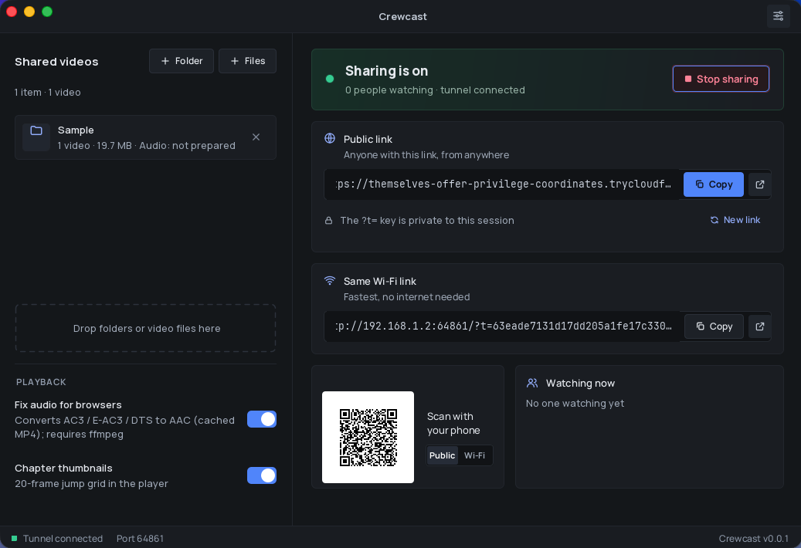
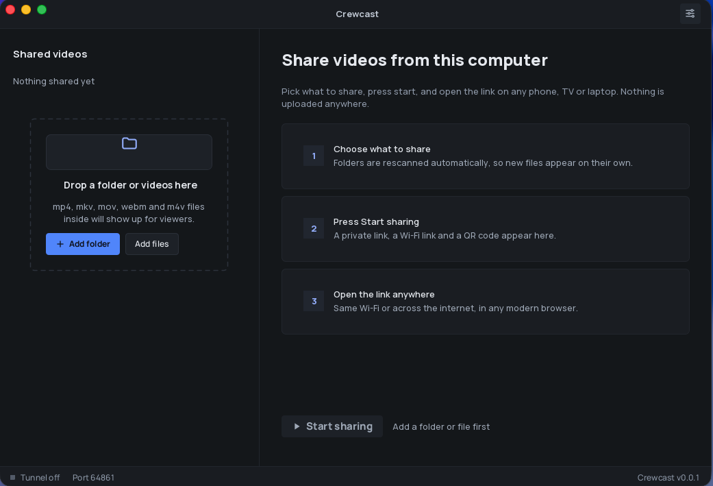
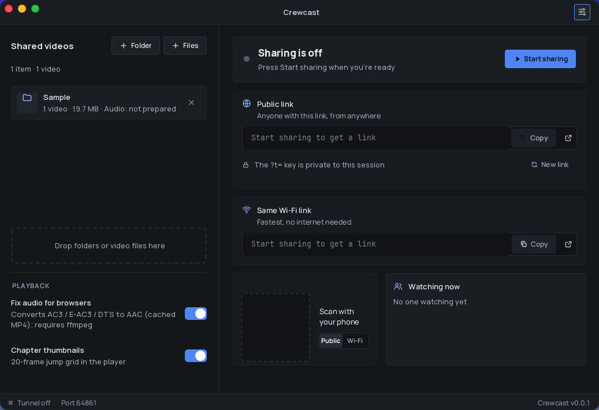

# Crewcast

[](https://github.com/vpjigin/CrewCast/releases/latest) [](LICENSE)

Share videos from your computer to any device, on your Wi‑Fi or over the internet, with no upload, no account and no cloud storage.



| Start screen | Dashboard |
|---|---|
|  |  |

**Crewcast** (by Solocrew) is a self-hosted Spring Boot app with a dark-themed desktop UI and a touch-friendly web player. Your files stay on your machine; viewers stream them while sharing is on.

---

## Download

| Platform | Download | Notes |
|----------|----------|-------|
| macOS, Apple Silicon (M1/M2/M3/M4) | [Crewcast-macos-arm64.dmg](https://github.com/vpjigin/CrewCast/releases/latest/download/Crewcast-macos-arm64.dmg) | Open the .dmg, drag Crewcast to Applications, then see [First launch on macOS](#first-launch-on-macos) below |
| macOS, Intel | [Crewcast-macos-x64.dmg](https://github.com/vpjigin/CrewCast/releases/latest/download/Crewcast-macos-x64.dmg) | Open the .dmg, drag Crewcast to Applications, then see [First launch on macOS](#first-launch-on-macos) below |
| Windows 10/11 (64-bit) | [Crewcast-windows-x64.msi](https://github.com/vpjigin/CrewCast/releases/latest/download/Crewcast-windows-x64.msi) | Run the installer |
| Linux, Debian/Ubuntu (64-bit) | [Crewcast-linux-x64.deb](https://github.com/vpjigin/CrewCast/releases/latest/download/Crewcast-linux-x64.deb) | `sudo apt install ./Crewcast-linux-x64.deb` |

### First launch on macOS

Installers are not signed with a paid Apple Developer ID yet, so the first time you open Crewcast macOS may show **“Crewcast Not Opened”** / **“Apple could not verify…”**.

**Fix 1 (fastest):** After dragging Crewcast to Applications, run this in Terminal, then open the app normally:

```bash
xattr -dr com.apple.quarantine /Applications/Crewcast.app
```

This only removes the “downloaded from the internet” quarantine flag from this app. If Crewcast is installed somewhere else, change the path in the command.

**Fix 2 (no Terminal):** Try to open the app, click **Done** on the dialog, then open **System Settings → Privacy & Security**, scroll to the message about Crewcast, and click **Open Anyway** (enter your password when prompted).

You can verify the download with the SHA256 checksum in **`SHA256SUMS.txt`** before running it.

Paid code signing is planned if the project is used widely; the source and the release workflow are public so anyone can check how the installers are built.

- [All releases and older versions](https://github.com/vpjigin/CrewCast/releases)
- **Verify a download** — each release includes **`SHA256SUMS.txt`**. After downloading the checksums file alongside your installer:
  - **macOS / Linux:** `shasum -a 256 Crewcast-macos-arm64.dmg` (replace with your filename) and compare to the line in `SHA256SUMS.txt`
  - **Windows (PowerShell):** `Get-FileHash -Algorithm SHA256 .\Crewcast-windows-x64.msi`
- **First launch on Windows** — **SmartScreen** may say **“Windows protected your PC”** — click **More info**, then **Run anyway**, because the installer is not code-signed yet.
- **Java is included**; you do not need to install anything else.
- **Linux arm64**, **Linux .rpm**, and **portable** builds are not available yet — [open an issue](https://github.com/vpjigin/CrewCast/issues/new) if you need one.

---

## Features

- **Public link** — HTTPS via a Cloudflare Quick Tunnel (automatic in the desktop app), plus a **Wi‑Fi link**, **QR code**, and copy buttons
- **Folder and file sharing** — add libraries or individual videos; rescans on each request (no restart when files change on disk); viewers can **Download all** on the web page as a zip of the current folder
- **Viewer list** — see who is watching (in memory only, not saved to disk)
- **Stay awake** — optional keep-awake while sharing is on (desktop)
- **Audio fix** — remux/transcode for browser playback (MKV, E‑AC3, AC3, DTS, etc.) with a per-video **language / track picker**
- **Compatibility mode** — optional H.264 + AAC conversion for TVs, projectors, and other browsers that cannot decode 10‑bit HEVC or exotic codecs (see [TVs and projectors](#tvs-and-projectors))
- **Subtitles** — embedded and sidecar text tracks as WebVTT in the player
- **Chapter thumbnails** — scrubbing grid (default 20 tiles) to jump through long videos
- **Access key** — a private `?t=` token per sharing session; **New link** rotates it
- **No accounts, no analytics** — nothing phones home to Solocrew

Supported video extensions: `.mp4`, `.mkv`, `.mov`, `.webm`, `.m4v`.

---

## Requirements

- **JDK 21+** and **Maven** to build and run from source (see [Run from source](#run-from-source))
- **Installers** for macOS (Apple Silicon and Intel), Windows, and Linux are built by **GitHub Actions** on each release — see [Download](#download)

---

## Run from source

```bash
git clone https://github.com/vpjigin/CrewCast.git
cd CrewCast
mvn -pl desktop -am install -DskipTests
mvn spring-boot:run -pl desktop
```

The embedded server binds to **`0.0.0.0` on a random port** (`server.port=0`). The desktop app shows the **Wi‑Fi** and **public** links (and QR) once sharing starts — there is no fixed port like 8080.

Add folders or files in the UI, configure playback options in the left panel, then click **Start sharing**.

---

## Releases

Official builds are produced when you push a **`v*`** tag (see [docs/RELEASING.md](docs/RELEASING.md)). Installers appear on the GitHub **Releases** page:

- `Crewcast-macos-arm64.dmg`, `Crewcast-macos-x64.dmg`
- `Crewcast-windows-x64.msi`
- `Crewcast-linux-x64.deb`
- **`SHA256SUMS.txt`** — verify downloads with `shasum -a 256 -c SHA256SUMS.txt`

Installers are **unsigned**. **macOS** Gatekeeper and **Windows** SmartScreen may warn on first run; see [First launch on macOS](#first-launch-on-macos) in the Download section and **More info → Run anyway** on Windows when you trust the file.

---

## How sharing works

Shared folders expose **every file type** for download; the web library can **view photos and videos in the browser** only — other types download to the device. **Hidden files** (names starting with `.`, OS-hidden, `.git`, `node_modules`, and junk like `.DS_Store`) are skipped when scanning folders.

| Link | What it is |
|------|------------|
| **Public** | `https://….trycloudflare.com/?t=…` — HTTPS through Cloudflare’s Quick Tunnel to your computer |
| **Wi‑Fi** | `http://<your-LAN-IP>:<port>/?t=…` — direct on the local network |

The **`t` query parameter** is the access key for this sharing session. Anyone with the **full public link** (including `t`) can open the library and watch **while sharing is on**. Treat it like a password.

- **New link** (desktop) — generates a new access key; old links stop working
- **Stop sharing** — ends the session; links return **503 Sharing is off** until you start again

By default, **Require private key** is on. On the same Wi‑Fi, the app can allow LAN clients without the key (Settings); tunnel visitors always need the key when it is required.

Cloudflared is downloaded once into `~/.crewcast/bin/` if it is not already on your `PATH` (see [PRIVACY.md](PRIVACY.md)).

---

## Headless mode

Build the executable server JAR:

```bash
mvn -pl server -am package -DskipTests
java -jar server/target/crewcast-server-0.0.1-SNAPSHOT-exec.jar \
  --share /path/to/folder-or-file \
  [--share /another/path ...] \
  [--port N] \
  [--no-tunnel] \
  [--download-ffmpeg]
```

| Flag | Purpose |
|------|---------|
| `--share` | Folder or file to share (repeatable). Required. |
| `--port` | Listen port (default **random**, same as desktop). Use `0` for random. |
| `--no-tunnel` | Do not start the Cloudflare tunnel; LAN access only. |
| `--download-ffmpeg` | Download and install ffmpeg/ffprobe under `~/.crewcast/bin/` (non-interactive consent for headless). |

Headless mode prints **LAN** and **Public** URLs when ready. Press **Ctrl+C** to stop (tunnel and server shut down cleanly).

---

## TVs and projectors

Many **built-in TV and projector browsers** play **AAC audio** from MKV/MP4 but show a **black or blocky picture** when the video is **10‑bit HEVC (x265)**, high H.264 profiles, or other codecs the chip cannot decode.

**Compatibility mode** (toggle in the web player, or enabled automatically on TV-like browsers when the file looks risky) streams a cached **MP4** with **8‑bit H.264 (yuv420p, High profile)** and **AAC**, scaled to at most **1080p** or **720p** (Settings → **Maximum height**). **Download** always serves the **original file**.

In the **desktop app → Settings → Playback** you can **pre-make TV versions** before anyone watches:

| Setting | Meaning |
|---------|---------|
| **TV / projector compatible versions** | **Off** · **Only files that need it** (HEVC, 10‑bit, etc.) · **All videos** |
| **Maximum height** | 1080p or 720p for the converted copy |
| **Allow viewers to start conversions** | When off, viewers only get versions you prepared on the host |

The share list shows a small **status icon** per video (and per file inside shared folders): not needed · queued · converting · ready · cannot convert. Use the **TV** menu on a row to **Prepare TV version** or **Cancel**. Folder rows include a summary such as “TV version: 2 ready, 1 converting 43%”.

- **Hardware encoder required** — the bundled ffmpeg is an LGPL build **without libx264**. Crewcast picks a **hardware H.264 encoder** on your OS (e.g. VideoToolbox on Mac, NVENC/QSV/AMF on Windows, VAAPI/NVENC on Linux). If none works, the desktop app and web player show a clear error; use **VLC** on the TV if needed.
- **First conversion takes time** — one cached copy per file (default audio track). Other audio tracks are still converted on demand. Cache lives under `~/.crewcast/cache/` (same size limit as audio conversions).
- **Subtitles, chapters, seeking, and audio track selection** work in compatibility mode the same as direct play.

## Audio fix and ffmpeg

When **Fix audio for browsers** is enabled, Crewcast converts non-browser audio (AC3, E‑AC3, DTS, etc.) and non‑MP4 containers into a cached **MP4** with **AAC stereo**, video copied through (HEVC gets an `hvc1` tag where needed). Cover-art / attached-picture streams are ignored.

### ffmpeg availability

- **Lookup order:** configured path → `~/.crewcast/bin/` → `PATH` / common install locations
- **Desktop — proactive prompt:** If ffmpeg is missing, the app may show **Enable audio support?** when you **Start sharing** (once per run) or when you add a folder/file that includes non‑`.mp4`/`.m4v`/`.mov` video (e.g. `.mkv`). **Download**, **Choose existing…**, or **Not now** (turns the toggle off until you enable it again). See [docs/FFMPEG-SOURCES.md](docs/FFMPEG-SOURCES.md) for allow-listed download hosts and licenses.
- **Settings → Download ffmpeg** — same verified download flow anytime
- **Headless:** `--download-ffmpeg` before sharing
- **Manual install:** `brew install ffmpeg`, `winget install ffmpeg`, `apt install ffmpeg`, etc., then **Re-check ffmpeg** in Settings

See [Development → Tests](#development) for the full test matrix (CI vs local e2e).

### Cache and playback

- **Cache:** `~/.crewcast/cache/` (or `$crewcast.home/cache`). Default cap **20 GB** with LRU eviction. **Clear audio cache** in Settings removes converted files.
- **Preferred language** — Settings chooses a default track (e.g. tagged Hindi, Malayalam); the player **Audio** control overrides per video (`localStorage`: `crewcast-audio-{id}`).
- **First play** of a track that is not ready yet — **503** on the stream plus a **preparing audio** overlay with progress; poll `/api/videos/{id}/audio-status`.
- **HEVC** — conversion keeps HEVC video but some browsers still struggle; the player may show a short notice.
- Remuxed audio cache uses `-sn`; captions are served separately via WebVTT URLs.

---

## Subtitles

The web player **Captions** menu (keyboard **c**) shows **Off** plus every **supported** text track. Choices are remembered per video in `localStorage` (`crewcast-captions-{id}`).

- **Embedded** — SubRip, ASS/SSA, `mov_text`, and WebVTT streams are listed in `GET /api/videos/{id}` and converted to WebVTT on first request (cached under `~/.crewcast/cache/subtitles/`, separate from the audio remux cache).
- **Sidecar** — In the same folder as `film.mkv`, Crewcast also looks for `film.srt`, `film.vtt`, `film.en.srt`, `film.ml.srt`, and similar two- or three-letter language suffixes. Sidecars are transcoded to UTF-8 WebVTT (SRT timestamps normalized, charset detected from BOM / heuristics).
- **Bitmap subtitles** (PGS, DVD, DVB, etc.) appear in the API with `supported: false` but are not served yet.
- **Settings → Default captions** — Off (default), match **preferred audio language**, or **English** when the viewer has not picked captions before.

---

## Player usage

Dark-themed full-screen player at `/watch/{id}`:

- **Tap the video** (or click) to play/pause; center icon feedback
- **Bottom bar** — seek slider, time, **−10s**, play/pause, **+10s**, mute
- **Top bar** — **Audio** track (when multiple tracks exist), **Captions**, playback **speed** (0.5×–2×), **Chapters** grid, **fullscreen**
- **Audio** — dropdown for quick switches; first-time or heavy tracks may open a **Choose audio language** panel with readiness hints
- **Chapters** — grid of thumbnails across the timeline (count from Settings, default 20); first open may take a few seconds while frames are captured
- Controls auto-hide while playing; tap or move the pointer to show them again

Home page `/` lists all shared files in a grid (requires a valid access key when sharing is on and the key is required). Tap a file for preview, download, or in-browser viewing of images and videos.

---

## Privacy

Crewcast contacts the network only for:

| Purpose | Destination |
|---------|-------------|
| Public tunnel | Cloudflare (Quick Tunnel) |
| `cloudflared` binary | GitHub API + GitHub releases (`cloudflare/cloudflared`) on first tunnel use if needed |
| Optional **ffmpeg** download | Allow-listed hosts in [docs/FFMPEG-SOURCES.md](docs/FFMPEG-SOURCES.md), **only after you consent** (desktop) or `--download-ffmpeg` (headless) |

There is **no** Solocrew account, analytics SDK, or third-party CDN in the web player.

- Active **viewers** — kept in memory (~30 seconds) for the desktop UI; not written to disk
- Access key — generated when sharing starts; **not** stored in `settings.json`

More detail: [PRIVACY.md](PRIVACY.md), [TERMS.md](TERMS.md), [docs/PRIVACY-INVENTORY.md](docs/PRIVACY-INVENTORY.md).

---

## Troubleshooting

Download or tunnel problems on Windows (no console):

1. Open **Settings → Open log folder** and check **`crewcast.log`** (also under `%USERPROFILE%\.crewcast\logs\` on Windows).
2. Run **Settings → Run diagnostics** (or headless: `java -jar …-exec.jar --diagnose` with no `--share`) to test reachability of GitHub and ffmpeg hosts, proxy, and trust store.
3. Use **Copy details** on ffmpeg or tunnel error dialogs to paste the reason, URL, and log path into a bug report.

If HTTPS downloads fail with a certificate warning, your PC or antivirus may be intercepting TLS — try `-Dcrewcast.useJavaTrustStore=true` or install the inspection CA in Windows.

---

## Known limitations

- **Quick tunnels** — Cloudflare Quick Tunnel URLs are best-effort; no uptime SLA. Use **Wi‑Fi** or `--no-tunnel` if you need LAN-only.
- **Disk use** — Each prepared **audio language** is a separate converted MP4 in cache (up to the **20 GB** cap); multi-track movies can use significant space.
- **HEVC (H.265)** — May not play in every browser even after remux; Safari often fares better than Chrome on some files.
- **Bitmap subtitles** — Detected but not converted; use text-based tracks or sidecars.
- **Builds** — Source builds are **unsigned**; verify and build yourself if that matters for your environment.
- **Chapters** — First open per video seeks through the file to build thumbnails; cached for the session afterward.

---

## Project structure

```
CrewCast/
├── pom.xml                    # parent — Java 21, Spring Boot 3.3.x
├── server/                    # crewcast-server (library + headless exec JAR)
│   └── src/main/java/com/solocrew/crewcast/
│       ├── CrewcastApplication.java, ServerApp.java
│       ├── VideoController.java, SubtitleController.java
│       ├── facade/            # SharingService, UI listeners
│       ├── share/, access/, web/, viewers/, tunnel/, system/, settings/, media/
│       └── resources/static/  # index.html, player/
└── desktop/                   # crewcast-desktop — Swing UI (DesktopApp)
    └── src/main/java/com/solocrew/crewcast/desktop/
```

Data directory: `~/.crewcast/` (settings, cache, optional `bin/` for cloudflared and ffmpeg). Legacy `~/.lanstream` is migrated on first run.

---

## Key endpoints

| Endpoint | Purpose |
|----------|---------|
| `GET /` | Home page (shared file grid) |
| `GET /api/files` | JSON list of shared files (kind, size, modified time) |
| `GET /file/{id}?download=1` | Download a shared file (`Content-Disposition: attachment`) |
| `GET /watch/{id}` | Player page |
| `GET /stream/{id}` | Range-request video stream (`?audio=N`, `?t=` when required) |
| `GET /api/videos` | JSON list `{ id, title }` |
| `GET /api/videos/{id}` | Metadata (audio tracks, subtitles, chapters flag, progress) |
| `GET /api/videos/{id}/audio-status` | Audio preparation progress |
| `POST /api/videos/{id}/audio/prepare` | Start preparing a track |
| `GET /subtitles/{id}/{index}.vtt` | WebVTT captions (UTF-8) |

When sharing is off, protected routes respond with **503**. When **Require private key** is on, missing or wrong `t` yields **403** (except configured LAN bypass).

---

## Development

### Tests

CI runs unit/integration tests only (no ffmpeg or Playwright on the runner):

```bash
mvn -B verify -DexcludedGroups=e2e
```

Before a release, run the **e2e** suite locally (needs **ffmpeg** and **ffprobe** on `PATH`, plus Playwright Chromium — install once with `mvn exec:java -pl server -e -D exec.mainClass=com.microsoft.playwright.CLI -D exec.args="install chromium"`):

```bash
mvn -pl server test
# or e2e only:
mvn -pl server test -Dgroups=e2e
```

Plain `mvn -pl server test` does **not** download ffmpeg. Optional real-download test (network, macOS):

```bash
mvn -pl server test -Dgroups=e2e -Dcrewcast.ffmpeg.e2e=true
```

Without ffmpeg, e2e classes are **skipped** (not errors). With `-DexcludedGroups=e2e`, they are not loaded at all (same as CI).

---

## Contributing

Bug reports and ideas are welcome via [GitHub Issues](https://github.com/vpjigin/CrewCast/issues). There is no PR template yet; small focused changes are easiest to review.

---

## Contact

- **Bugs and feature requests** — [GitHub Issues](https://github.com/vpjigin/CrewCast/issues) on [github.com/vpjigin/CrewCast](https://github.com/vpjigin/CrewCast)
- **Security problems** — Use the repository’s **Report a vulnerability** button (Security tab), or email [solocrew.me@gmail.com](mailto:solocrew.me@gmail.com). Do not post vulnerabilities in public issues.
- **General questions and business enquiries** — [solocrew.me@gmail.com](mailto:solocrew.me@gmail.com)

---

## License

Crewcast is released under the [MIT License](LICENSE). Third-party libraries and fonts are listed in [THIRD-PARTY-NOTICES.md](THIRD-PARTY-NOTICES.md).

The names **Crewcast** and **Solocrew** are not licensed for use as product names by others; the source code is free to use, copy, modify, and distribute under MIT.
