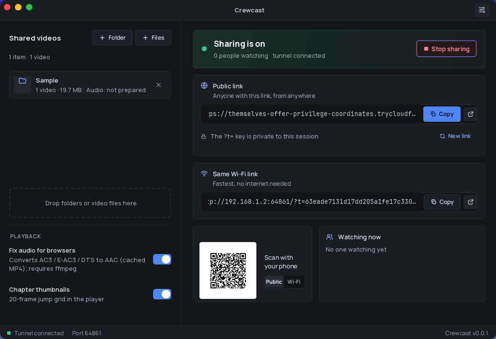
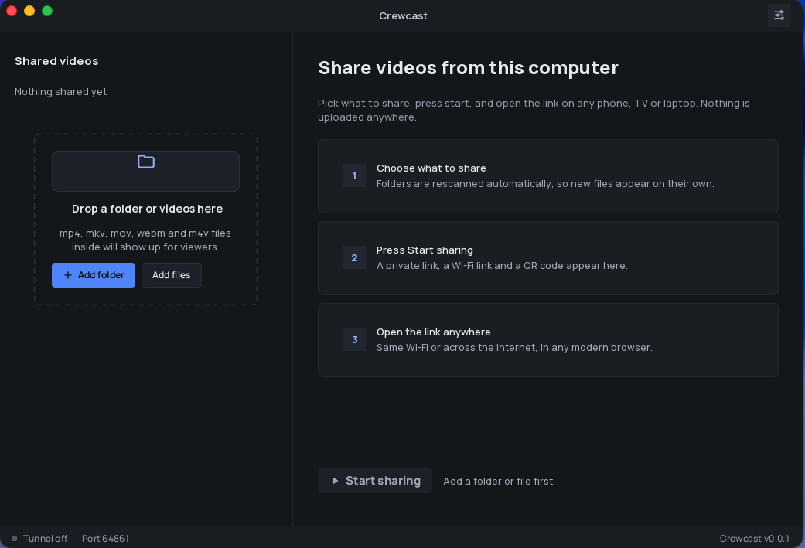
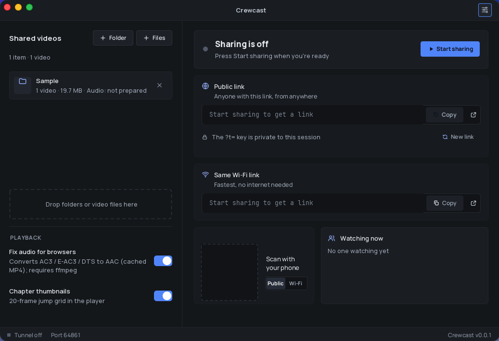
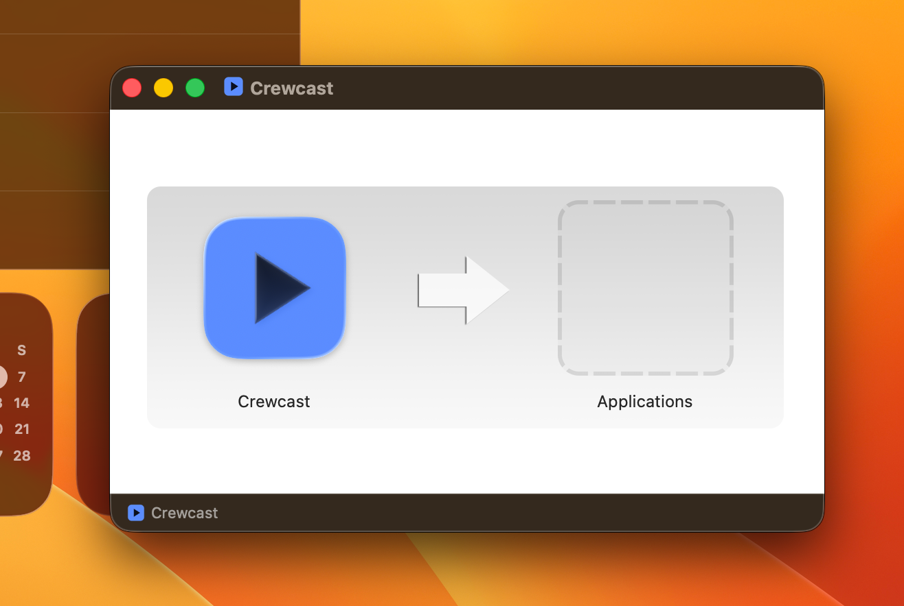

<div align="center">

# Crewcast

**Share videos from your computer to any phone, TV or laptop — on your Wi‑Fi or over the internet.**
No upload, no account, no cloud storage.

[](https://github.com/vpjigin/CrewCast/releases/latest) [](LICENSE)



</div>

| Start screen | Dashboard |
|---|---|
|  |  |

**Crewcast** (by Solocrew) runs on your computer and turns any folder into a private streaming link. Your files stay on your machine; viewers watch them in their browser while sharing is on.

---

<div align="center">

<a id="how-to-install"></a>

## ⬇️ How to install

Pick your computer below and follow the steps. It takes about 2 minutes.<br>
Java is included — **you don't need to install anything else.**

<a href="https://github.com/vpjigin/CrewCast/releases/latest/download/Crewcast-macos-arm64.dmg"></a>
<a href="https://github.com/vpjigin/CrewCast/releases/latest/download/Crewcast-macos-x64.dmg"></a>
<a href="https://github.com/vpjigin/CrewCast/releases/latest/download/Crewcast-windows-x64.msi"></a>
<a href="https://github.com/vpjigin/CrewCast/releases/latest/download/Crewcast-linux-x64.deb"></a>

<sub>The buttons always download the latest version. Older versions: <a href="https://github.com/vpjigin/CrewCast/releases">all releases</a>.</sub>

</div>

> **Why the security warnings?** Crewcast is free and open source, and the installers are not yet signed with a paid Apple / Microsoft certificate. Your computer will warn you the first time you open it. The steps below show exactly how to get past that safely. The installers are built in public by [GitHub Actions](.github/workflows/release.yml) from this source code.

<details>
<summary><b>🍎 &nbsp;macOS</b> &nbsp;— Apple Silicon (M1–M4) or Intel</summary>

<br>

**Step 1 — Check which Mac you have**

Click the Apple menu (top‑left corner) → **About This Mac**.
- If it says **Chip: Apple M1 / M2 / M3 / M4** → you need **Apple Silicon**
- If it says **Processor: Intel** → you need **Intel**

**Step 2 — Download**

- Apple Silicon: [Crewcast-macos-arm64.dmg](https://github.com/vpjigin/CrewCast/releases/latest/download/Crewcast-macos-arm64.dmg)
- Intel: [Crewcast-macos-x64.dmg](https://github.com/vpjigin/CrewCast/releases/latest/download/Crewcast-macos-x64.dmg)

**Step 3 — Install**

Open the downloaded `.dmg` file (usually in **Downloads**). In the window that appears, **drag the Crewcast icon onto the Applications folder**. Then eject the Crewcast disk in Finder.

<p align="center"></p>

**Step 4 — Allow Crewcast to open (one time only)**

Because the app isn't signed yet, macOS will show **"Crewcast Not Opened"** or **"Apple could not verify…"** if you open it straight away. Choose **one** of these:

**Option A — Terminal (fastest)**

1. Press **⌘ Command + Space**, type **Terminal**, and press **Return**
2. Copy this line, paste it into Terminal, and press **Return**:

   ```bash
   xattr -dr com.apple.quarantine /Applications/Crewcast.app
   ```

3. Nothing is printed if it worked. You can close Terminal.

This only removes the "downloaded from the internet" flag from Crewcast. Nothing else on your Mac changes.

**Option B — System Settings (no Terminal)**

1. Open Crewcast from **Applications**. When the warning appears, click **Done**
2. Open the Apple menu → **System Settings** → **Privacy & Security**
3. Scroll down to the message about Crewcast and click **Open Anyway**
4. Enter your Mac password, then click **Open Anyway** again

<sub>On macOS 14 (Sonoma) or older you can also right‑click Crewcast in Applications → **Open** → **Open**.</sub>

**Step 5 — Open Crewcast**

Open **Crewcast** from **Applications** or Launchpad. If macOS asks whether Crewcast may **accept incoming network connections**, click **Allow** — this is what lets phones and TVs connect to it.

✅ Done! Now see [Start sharing](#start-sharing).

</details>

<details>
<summary><b>🪟 &nbsp;Windows</b> &nbsp;— Windows 10 / 11 (64‑bit)</summary>

<br>

**Step 1 — Download**

Download [Crewcast-windows-x64.msi](https://github.com/vpjigin/CrewCast/releases/latest/download/Crewcast-windows-x64.msi).

If your browser says the file *"isn't commonly downloaded"*, choose **⋯ → Keep** (Edge) or **Keep** (Chrome).

**Step 2 — Run the installer**

Open `Crewcast-windows-x64.msi` from your **Downloads** folder.

**Step 3 — Get past SmartScreen (one time only)**

Windows may show a blue box saying **"Windows protected your PC"**.

1. Click **More info**
2. Click **Run anyway**

**Step 4 — Finish the installer**

Click **Next**, choose where to install (the default is fine), then **Install**. Click **Yes** if Windows asks for permission, then **Finish**.

**Step 5 — Open Crewcast**

Open **Crewcast** from the **desktop shortcut** or the **Start menu**.

If **Windows Defender Firewall** asks about Crewcast, tick **Private networks** and click **Allow access** — this is what lets phones and TVs on your Wi‑Fi connect to it.

✅ Done! Now see [Start sharing](#start-sharing).

</details>

<details>
<summary><b>🐧 &nbsp;Linux</b> &nbsp;— Debian / Ubuntu / Linux Mint (64‑bit)</summary>

<br>

**Step 1 — Download**

Download [Crewcast-linux-x64.deb](https://github.com/vpjigin/CrewCast/releases/latest/download/Crewcast-linux-x64.deb).

**Step 2 — Install**

Open a terminal (**Ctrl + Alt + T** on Ubuntu) and run:

```bash
cd ~/Downloads
sudo apt install ./Crewcast-linux-x64.deb
```

Enter your password when asked. (The `./` in front of the file name is important.)

**Step 3 — Open Crewcast**

```bash
/opt/crewcast/bin/crewcast
```

✅ Done! Now see [Start sharing](#start-sharing).

<sub>Linux arm64, `.rpm` and portable builds are not available yet — <a href="https://github.com/vpjigin/CrewCast/issues/new">open an issue</a> if you need one.</sub>

</details>

<details>
<summary><b>🔄 &nbsp;Updating or uninstalling</b></summary>

<br>

**Update:** download the latest installer with the buttons above and install it over the old version. Your settings are kept.

**Uninstall:**
- **macOS:** drag **Crewcast** from Applications to the Trash
- **Windows:** **Settings → Apps → Installed apps → Crewcast → Uninstall**
- **Linux:** `sudo apt remove crewcast`

Crewcast keeps its settings, cache and downloaded helpers (ffmpeg, cloudflared) in a `.crewcast` folder in your home folder. Delete it too if you want to remove everything.

</details>

<details>
<summary><b>🔐 &nbsp;Verify your download (optional)</b></summary>

<br>

Each release includes **`SHA256SUMS.txt`**. Download it from the [latest release](https://github.com/vpjigin/CrewCast/releases/latest), then compare it with your file:

- **macOS / Linux:** `shasum -a 256 Crewcast-macos-arm64.dmg` (use your file name)
- **Windows (PowerShell):** `Get-FileHash -Algorithm SHA256 .\Crewcast-windows-x64.msi`

The result should match the line for that file in `SHA256SUMS.txt`.

</details>

---

<a id="start-sharing"></a>

## ▶️ Start sharing

1. Open Crewcast and click **Add folder** (or **Add files**) to pick the videos you want to share
2. Click **Start sharing**
3. Send the link to your viewers — use **Copy** next to the **Public link** (works anywhere) or the **Same Wi‑Fi link** (same network only), or let them scan the **QR code**
4. Viewers open the link in any browser and tap a video to watch. Nothing to install on their side

Click **Stop sharing** when you're done — the link stops working immediately. **New link** gives you a fresh link and turns off the old one.

> Your computer must stay on and awake while people are watching. Turn on **Keep computer awake while sharing** in Crewcast to stop it from sleeping.

---

## Features

- **Public link** — HTTPS via a Cloudflare Quick Tunnel (automatic in the desktop app), plus a **Wi‑Fi link**, **QR code**, and copy buttons
- **Folder and file sharing** — add libraries or individual files on the host; rescans on each request (no restart when files change on disk)
- **Web library** — browse shared folders (breadcrumbs and back); tap any file for a popup with **Download**, **Watch** (videos), or **View** (images); **Download all** streams the current folder as a zip — zips are streamed with no total size limit, but a single download is limited to 10,000 files (configurable with `crewcast.download-all.max-entries`) and 2 concurrent downloads
- **Viewer list** — see who is watching (in memory only, not saved to disk)
- **Stay awake** — optional keep-awake while sharing is on (desktop)
- **Audio fix** — remux/transcode for browser playback (MKV, E‑AC3, AC3, DTS, etc.) with a per-video **language / track picker**
- **TV / projector compatibility mode** — optional H.264 + AAC conversion for devices that cannot decode 10‑bit HEVC or exotic codecs (web player toggle and/or host prep in Settings; see [TVs and projectors](#tvs-and-projectors))
- **Subtitles** — embedded and sidecar text tracks as WebVTT in the player
- **Chapter thumbnails** — scrubbing grid (default 20 tiles) to jump through long videos
- **Access key** — a private `?t=` token per sharing session; **New link** rotates it
- **No accounts, no analytics** — nothing phones home to Solocrew

Supported video extensions: `.mp4`, `.mkv`, `.mov`, `.webm`, `.m4v`.

---

## Run from source

Needs **JDK 21+** and **Maven**.

```bash
git clone https://github.com/vpjigin/CrewCast.git
cd CrewCast
mvn -pl desktop -am install -DskipTests
mvn spring-boot:run -pl desktop
```

The embedded server binds to **`0.0.0.0` on a random port** (`server.port=0`). The desktop app shows the **Wi‑Fi** and **public** links (and QR) once sharing starts — there is no fixed port like 8080.

---

## Releases

Official builds are produced when a **`v*`** tag is pushed (see [docs/RELEASING.md](docs/RELEASING.md)). Each release on the GitHub **Releases** page contains:

- `Crewcast-macos-arm64.dmg`, `Crewcast-macos-x64.dmg`
- `Crewcast-windows-x64.msi`
- `Crewcast-linux-x64.deb`
- **`SHA256SUMS.txt`** — verify downloads with `shasum -a 256 -c SHA256SUMS.txt`

Installers are **unsigned** for now. Paid code signing is planned if the project is used widely.

---

## How sharing works

Shared folders expose **every file type** for download. On the web library you can **browse subfolders**, open a popup on any file (**Download**; **Watch** or **View** for videos and images), and **watch** videos or **view** photos in the browser — other types download to the device. **Hidden files** (names starting with `.`, OS-hidden, `.git`, `node_modules`, and junk like `.DS_Store`) are skipped when scanning folders.

| Link | What it is |
|------|------------|
| **Public** | `https://….trycloudflare.com/` — HTTPS through Cloudflare’s Quick Tunnel to your computer (`?t=…` when Require private key is on) |
| **Wi‑Fi** | `http://<your-LAN-IP>:<port>/` — direct on the local network (`?t=…` when the key is required) |

When **Require private key** is on, the **`t` query parameter** is the access key for this sharing session — treat it like a password. With the key off, anyone who has the link can open the library and watch **while sharing is on**.

- **New link** (desktop) — generates a new access key; old links (and the 7‑day browser cookie set after a valid key) stop working. Restarting sharing also rotates the key.
- **Stop sharing** — ends the session; links return **503 Sharing is off** until you start again

By default, **Require private key** is on and **Allow same‑Wi‑Fi access** is off. When same‑Wi‑Fi access is on, devices on your network can open the link without the key; tunnel visitors always need the key when it is required. After a successful key, the browser keeps a 7‑day access cookie so later visits without `?t=` still work until **New link** or a new sharing session.

Cloudflared is downloaded once into `~/.crewcast/bin/` if it is not already on your `PATH` (see [PRIVACY.md](PRIVACY.md)).

---

## Headless mode

Build the executable server JAR:

```bash
mvn -pl server -am package -DskipTests
java -jar server/target/crewcast-server-0.0.1-SNAPSHOT-exec.jar \
  --share /path/to/folder-or-file \
  [--share /another/path ...] \
  [--port N] \
  [--no-tunnel] \
  [--download-ffmpeg]
```

| Flag | Purpose |
|------|---------|
| `--share` | Folder or file to share (repeatable). Required. |
| `--port` | Listen port (default **random**, same as desktop). Use `0` for random. |
| `--no-tunnel` | Do not start the Cloudflare tunnel; LAN access only. |
| `--download-ffmpeg` | Download and install ffmpeg/ffprobe under `~/.crewcast/bin/` (non-interactive consent for headless). |

Headless mode prints **LAN** and **Public** URLs when ready. Press **Ctrl+C** to stop (tunnel and server shut down cleanly).

---

## TVs and projectors

Many **built-in TV and projector browsers** play **AAC audio** from MKV/MP4 but show a **black or blocky picture** when the video is **10‑bit HEVC (x265)**, high H.264 profiles, or other codecs the chip cannot decode.

Crewcast can **convert those files to 8‑bit H.264 + AAC** automatically in the **web player** (compatibility toggle, or auto-enabled on TV-like browsers when the file looks risky) or **ahead of time on the host** (Settings below). The converted stream is a cached **MP4** (**yuv420p**, High profile), scaled to at most **1080p** or **720p** (Settings → **Maximum height (TV version)**). **Download** always serves the **original file**.

In the **desktop app → Settings → Playback** you can **pre-make TV versions** before anyone watches:

| Setting | Meaning |
|---------|---------|
| **TV / projector compatible versions** | **Off** · **Only files that need it** · **All videos** |
| **Maximum height (TV version)** | 1080p or 720p for the converted copy |
| **Allow viewers to start conversions** | When off, viewers only get versions you prepared on the host |

The share list shows a small **status icon** per video (and per file inside shared folders): not needed · queued · converting · ready · cannot convert. Use the **TV** menu on a row to **Prepare TV version** or **Cancel**. Folder rows include a summary such as “TV version: 2 ready, 1 converting 43%”.

- **Hardware encoder required** — the bundled ffmpeg is an LGPL build **without libx264**. Crewcast picks a **hardware H.264 encoder** on your OS (VideoToolbox on macOS, NVENC/QSV/AMF on Windows, VAAPI/NVENC/QSV on Linux). If none is available, **browser-safe files still play as the original**; files that would need a TV version show **why conversion is unavailable** in the share list and web player (compatibility mode stays off or disabled). Use **VLC** on the TV if the built-in browser cannot decode the original.
- **First conversion takes time** — one cached copy per file (default audio track). Other audio tracks are still converted on demand. Cache lives under `~/.crewcast/cache/` (same size limit as audio conversions).
- **Subtitles, chapters, seeking, and audio track selection** work in compatibility mode the same as direct play.

## Audio fix and ffmpeg

When **Fix audio for browsers** is enabled, Crewcast converts non-browser audio (AC3, E‑AC3, DTS, etc.) and non‑MP4 containers into a cached **MP4** with **AAC stereo**, video copied through (HEVC gets an `hvc1` tag where needed). Cover-art / attached-picture streams are ignored.

### ffmpeg availability

- **Lookup order:** configured path → `~/.crewcast/bin/` → `PATH` / common install locations
- **Desktop — proactive prompt:** If ffmpeg is missing, the app may show **Enable audio support?** when you **Start sharing** (once per run) or when you add a folder/file that includes non‑`.mp4`/`.m4v`/`.mov` video (e.g. `.mkv`). **Download**, **Choose existing…**, or **Not now** (turns the toggle off until you enable it again). See [docs/FFMPEG-SOURCES.md](docs/FFMPEG-SOURCES.md) for allow-listed download hosts and licenses.
- **Settings → Download ffmpeg** — same verified download flow anytime
- **Headless:** `--download-ffmpeg` before sharing
- **Manual install:** `brew install ffmpeg`, `winget install ffmpeg`, `apt install ffmpeg`, etc., then **Re-check ffmpeg** in Settings

See [Development → Tests](#development) for the full test matrix (CI vs local e2e).

### Cache and playback

- **Cache:** `~/.crewcast/cache/` (or `$crewcast.home/cache`). Default cap **20 GB** with LRU eviction. **Clear audio cache** in Settings removes converted files.
- **Preferred language** — Settings chooses a default track (e.g. tagged Hindi, Malayalam); the player **Audio** control overrides per video (`localStorage`: `crewcast-audio-{id}`).
- **First play** of a track that is not ready yet — **503** on the stream plus a **preparing audio** overlay with progress; poll `/api/videos/{id}/audio-status`.
- **HEVC** — conversion keeps HEVC video but some browsers still struggle; the player may show a short notice.
- Remuxed audio cache uses `-sn`; captions are served separately via WebVTT URLs.

---

## Subtitles

The web player **Captions** menu (keyboard **c**) shows **Off** plus every **supported** text track. Choices are remembered per video in `localStorage` (`crewcast-captions-{id}`).

- **Embedded** — SubRip, ASS/SSA, `mov_text`, and WebVTT streams are listed in `GET /api/videos/{id}` and converted to WebVTT on first request (cached under `~/.crewcast/cache/subtitles/`, separate from the audio remux cache).
- **Sidecar** — In the same folder as `film.mkv`, Crewcast also looks for `film.srt`, `film.vtt`, `film.en.srt`, `film.ml.srt`, and similar two- or three-letter language suffixes. Sidecars are transcoded to UTF-8 WebVTT (SRT timestamps normalized, charset detected from BOM / heuristics).
- **Bitmap subtitles** (PGS, DVD, DVB, etc.) appear in the API with `supported: false` but are not served yet.
- **Settings → Default captions** — Off (default), match **preferred audio language**, or **English** when the viewer has not picked captions before.

---

## Player usage

Dark-themed full-screen player at `/watch/{id}`:

- **Tap the video** (or click) to play/pause; center icon feedback
- **Bottom bar** — seek slider, time, **−10s**, play/pause, **+10s**, mute
- **Top bar** — **Audio** track (when multiple tracks exist), **Captions**, playback **speed** (0.5×–2×), **Chapters** grid, **fullscreen**
- **Audio** — dropdown for quick switches; first-time or heavy tracks may open a **Choose audio language** panel with readiness hints
- **Chapters** — grid of thumbnails across the timeline (count from Settings, default 20); first open may take a few seconds while frames are captured
- Controls auto-hide while playing; tap or move the pointer to show them again

Home page `/` lists shared files and folders in a grid (requires a valid access key when sharing is on and the key is required). Tap a file to open the popup (**Watch**, **View**, or **Download**); videos open the player at `/watch/{id}`.

---

## Privacy

Crewcast contacts the network only for:

| Purpose | Destination |
|---------|-------------|
| Public tunnel | Cloudflare (Quick Tunnel) |
| `cloudflared` binary | GitHub API + GitHub releases (`cloudflare/cloudflared`) on first tunnel use if needed |
| Optional **ffmpeg** download | Allow-listed hosts in [docs/FFMPEG-SOURCES.md](docs/FFMPEG-SOURCES.md), **only after you consent** (desktop) or `--download-ffmpeg` (headless) |

There is **no** Solocrew account, analytics SDK, or third-party CDN in the web player.

- Active **viewers** — kept in memory (~30 seconds) for the desktop UI; not written to disk
- Access key — generated when sharing starts; **not** stored in `settings.json`

More detail: [PRIVACY.md](PRIVACY.md), [TERMS.md](TERMS.md), [docs/PRIVACY-INVENTORY.md](docs/PRIVACY-INVENTORY.md).

---

## Troubleshooting

Download or tunnel problems on Windows (no console):

1. Open **Settings → Open log folder** and check **`crewcast.log`** (also under `%USERPROFILE%\.crewcast\logs\` on Windows).
2. Run **Settings → Run diagnostics** (or headless: `java -jar …-exec.jar --diagnose` with no `--share`) to test reachability of GitHub and ffmpeg hosts, proxy, and trust store.
3. Use **Copy details** on ffmpeg or tunnel error dialogs to paste the reason, URL, and log path into a bug report.

If HTTPS downloads fail with a certificate warning, your PC or antivirus may be intercepting TLS — try `-Dcrewcast.useJavaTrustStore=true` or install the inspection CA in Windows.

---

## Known limitations

- **Quick tunnels** — Cloudflare Quick Tunnel URLs are best-effort; no uptime SLA. Use **Wi‑Fi** or `--no-tunnel` if you need LAN-only.
- **Disk use** — Each prepared **audio language** is a separate converted MP4 in cache (up to the **20 GB** cap); multi-track movies can use significant space.
- **HEVC (H.265)** — May not play in every browser even after remux; Safari often fares better than Chrome on some files.
- **Bitmap subtitles** — Detected but not converted; use text-based tracks or sidecars.
- **Builds** — Source builds are **unsigned**; verify and build yourself if that matters for your environment.
- **Chapters** — First open per video seeks through the file to build thumbnails; cached for the session afterward.

---

## Project structure

```
CrewCast/
├── pom.xml                    # parent — Java 21, Spring Boot 3.3.x
├── server/                    # crewcast-server (library + headless exec JAR)
│   └── src/main/java/com/solocrew/crewcast/
│       ├── CrewcastApplication.java, ServerApp.java
│       ├── VideoController.java, SubtitleController.java
│       ├── facade/            # SharingService, UI listeners
│       ├── share/, access/, web/, viewers/, tunnel/, system/, settings/, media/
│       └── resources/static/  # index.html, player/
└── desktop/                   # crewcast-desktop — Swing UI (DesktopApp)
    └── src/main/java/com/solocrew/crewcast/desktop/
```

Data directory: `~/.crewcast/` (settings, cache, optional `bin/` for cloudflared and ffmpeg). Legacy `~/.lanstream` is migrated on first run.

---

## Key endpoints

| Endpoint | Purpose |
|----------|---------|
| `GET /` | Home page (shared file grid) |
| `GET /api/browse` | JSON folder listing (subfolders + files for the share root or `?folder=`) |
| `GET /api/files` | Flat JSON list of shared files (kind, size, modified time) |
| `GET /api/download-all` | Streamed zip of the current folder or entire share (`?folder=` optional) |
| `GET /file/{id}?download=1` | Download a shared file (`Content-Disposition: attachment`) |
| `GET /watch/{id}` | Player page |
| `GET /stream/{id}` | Range-request video stream (`?audio=N`, `?t=` when required) |
| `GET /api/videos` | JSON list `{ id, title }` |
| `GET /api/videos/{id}` | Metadata (audio tracks, subtitles, chapters flag, progress) |
| `GET /api/videos/{id}/audio-status` | Audio preparation progress |
| `POST /api/videos/{id}/audio/prepare` | Start preparing a track |
| `GET /subtitles/{id}/{index}.vtt` | WebVTT captions (UTF-8) |

When sharing is off, protected routes respond with **503**. When **Require private key** is on, missing or wrong `t` yields **403** (except an optional same‑Wi‑Fi LAN bypass, off by default; a valid 7‑day access cookie also grants access until the key is rotated).

---

## Development

### Tests

CI runs unit/integration tests only (no ffmpeg or Playwright on the runner):

```bash
mvn -B verify -DexcludedGroups=e2e
```

Before a release, run the **e2e** suite locally (needs **ffmpeg** and **ffprobe** on `PATH`, plus Playwright Chromium — install once with `mvn exec:java -pl server -e -D exec.mainClass=com.microsoft.playwright.CLI -D exec.args="install chromium"`):

```bash
mvn -pl server test
# or e2e only:
mvn -pl server test -Dgroups=e2e
```

Plain `mvn -pl server test` does **not** download ffmpeg. Optional real-download test (network, macOS):

```bash
mvn -pl server test -Dgroups=e2e -Dcrewcast.ffmpeg.e2e=true
```

Without ffmpeg, e2e classes are **skipped** (not errors). With `-DexcludedGroups=e2e`, they are not loaded at all (same as CI).

---

## Contributing

Bug reports and ideas are welcome via [GitHub Issues](https://github.com/vpjigin/CrewCast/issues). There is no PR template yet; small focused changes are easiest to review.

---

## Contact

- **Bugs and feature requests** — [GitHub Issues](https://github.com/vpjigin/CrewCast/issues) on [github.com/vpjigin/CrewCast](https://github.com/vpjigin/CrewCast)
- **Security problems** — Use the repository’s **Report a vulnerability** button (Security tab), or email [solocrew.me@gmail.com](mailto:solocrew.me@gmail.com). Do not post vulnerabilities in public issues.
- **General questions and business enquiries** — [solocrew.me@gmail.com](mailto:solocrew.me@gmail.com)

---

## License

Crewcast is released under the [MIT License](LICENSE). Third-party libraries and fonts are listed in [THIRD-PARTY-NOTICES.md](THIRD-PARTY-NOTICES.md).

The names **Crewcast** and **Solocrew** are not licensed for use as product names by others; the source code is free to use, copy, modify, and distribute under MIT.
